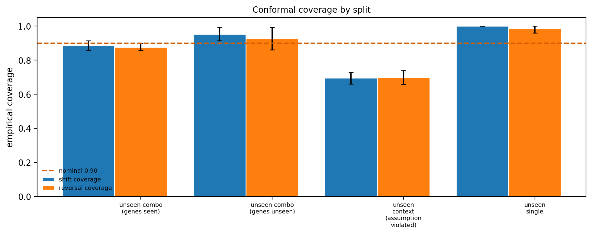
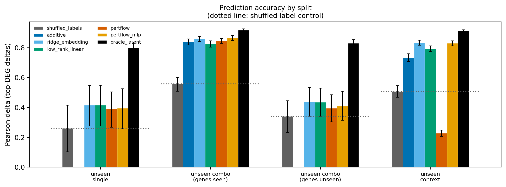

# Reversing resistance in silico

**Uncertainty-aware counterfactual search for interventions predicted to shift a
drug-resistant cell state toward a drug-sensitive transcriptional state — on a synthetic
simulator, with no wet-lab validation of any kind.**

Instead of modelling how to kill cancer cells, this project learns how perturbations move a
cell's transcriptional state, then searches for small interventions (at most three gene
knockdowns) predicted to move a resistant cell toward a sensitive one — while calibrating
when the model should not be trusted, and abstaining when it should not. Because the whole
study runs on a simulator we wrote, the true effect of *every* candidate intervention is
exactly knowable, which is what makes the uncertainty and abstention claims testable at all.
It is also the project's main limitation.

## Three findings, in plain language

**1. Calibrated uncertainty works — until the cell context changes, and then everything
fails at once.** Split-conformal intervals hit their 90% target almost exactly (88.8%) on
held-out perturbations. Move to a cell context the model never saw, and coverage falls to
69.6%, the uncertainty estimate becomes no better than a coin flip at spotting its own
errors (AUROC 0.507), and abstaining on the least-confident predictions stops helping. This
is the behaviour conformal theory predicts when its exchangeability assumption breaks, so it
is a *confirmation* rather than a discovery — but it is a sharp one, because all three
failures arrive together.

**2. How you measure a model changes which model looks best.** Ranking models by the
conventional accuracy metric and by how well they actually rank candidate interventions
gives a different winner in 5 of 8 comparisons. A control model fitted on *shuffled*
perturbation labels — which by construction knows nothing about which perturbation was
applied — still scores around half of the conventional metric. Much of what that metric
rewards does not require knowing the perturbation.

**3. Whether the deep model beats simple baselines is genuinely unresolved.** Across 20
paired comparisons it won decisively 4 times and lost decisively 3 times... but see the honest caveat
below: *the answer flips depending on a threshold we chose after seeing the results*, so we
report it as inconclusive rather than pick the flattering version.

## What we could not conclude

Negative and inconclusive results are reported here with the same prominence as the rest,
because several of them were initially written up as findings and only survived scrutiny as
non-findings.

- **Is the deep model better? Inconclusive.** The verdict depends on how "reliably beats" is
  defined, and the two definitions we tried disagree on this data. `DECISIONS.md` records
  every rule that changed after results arrived and what each would have concluded.
- **Does penalising uncertainty improve intervention search? Untestable here.** The search
  already finds 99.94% of the best possible intervention without any penalty, so there is no
  room left for one to help. This is a flaw in the experiment's design, not evidence against
  the idea.
- **Do models generalise to genes never perturbed in training? Too small to judge.** Those
  splits have 5 and 10 test perturbations per run. The models score above the shuffled
  control on average, but the intervals are far too wide to resolve.
- **One striking observation, still preliminary:** the flow model collapses on unseen cell
  contexts (0.229 versus 0.834 for ridge regression) while an otherwise identical model that
  skips the iterative integration step does not (0.830). Error appears to compound across
  integration steps under distribution shift. Supporting evidence exists only at small scale
  and on one seed; we have deliberately **not** claimed a cause.

## Figures

| | |
|---|---|
|  | Conformal coverage by split. Three splits reach the 90% target; the shifted split (third group) falls to 69.6%, where the guarantee does not apply. |
|  | Accuracy by split, with the shuffled-label control marked. Note the flow model's collapse on unseen context, and how wide the gene-holdout intervals are. |

## Limitations

- **The data is synthetic.** Every number comes from a simulator written for this project.
  Its structure encodes a hypothesis about how resistance states behave; it is not a
  measurement of one. `LOG.md` documents several occasions where a convincing result turned
  out to be an artefact of that simulator's construction.
- **No wet-lab validation.** Nothing here has been tested in cells, and the gap between a
  predicted transcriptional shift in a simulator and any clinical effect is enormous and
  unquantified. Nothing in this repository should be read as a therapeutic recommendation.
- **The sensitivity score is a learned proxy** and its two independent readouts disagree
  sharply on predicted post-perturbation states.
- **Analysis rules were revised after seeing results.** This is logged in `DECISIONS.md`
  with the counterfactual verdicts, rather than presented as a clean story.
- **Only 5 seeds**, which cannot reach conventional statistical significance under the
  paired test used (p < 0.0625 is the floor), so results are reported as intervals and
  effect sizes.

## Reproducing it

```bash
pip install -r requirements.txt
make test        # 140 tests
make smoke       # whole pipeline, small profile, CPU, ~15 min
make reproduce   # full profile; regenerates every table and figure (~9 h CPU)
```

There is no GPU on the development machine, so the full profile is sized for CPU. Every
results file records the git commit, config and library versions, and carries a `real` or
`synthetic` provenance tag.

## Status

| milestone | content | state |
|---|---|---|
| M0-M5 | simulator, splits, baselines, PertFlow, conformal, search | done |
| full run | 5 seeds, three hypotheses, figures | done (8 h 41 m CPU) |
| M6 | real sensitive/resistant data | not started |
| M7 | active learning | not started |
| M8 | mechanistic anchoring | not started |

## Method

- **Latent state** `z`: HVG selection, standardisation and PCA, all fitted on training cells
  only. Linear, so the decoder is exact and gene-space deltas are recoverable.
- **Response model** `f(z0, S)`: *PertFlow*, conditional flow matching on the marginal
  velocity field `v(z_t, t | S, context)`, with a DeepSets encoder over per-gene
  co-expression profiles so unseen combinations and unseen genes are representable. Deep
  ensemble of `M = 5`.
- **Sensitivity functional** `s(z)` in [0,1]: fitted on a **disjoint** experiment
  (unperturbed sensitive vs resistant cells, separate simulation seed). Two independent
  readouts — a latent classifier and a low-capacity expression signature — reported
  separately, never averaged.
- **Reversal score** `R(z0, S) = E[s(z')] - s(z0)`, plus energy distance from the predicted
  population to the sensitive-state distribution.
- **Uncertainty** `U(S)`: deep-ensemble disagreement on the predicted mean shift, turned
  into intervals by split conformal with the normalised score `|y - yhat| / spread`,
  calibrated on **held-out perturbations**.
- **Search**: `argmax E[R] - lambda * U(S)` over sets of size <= k by greedy, beam and
  evolutionary search, with exhaustive search as a reference so that search error and model
  error can be told apart. Abstains when `U` exceeds a calibrated threshold.

## Hypotheses and verdicts

| | hypothesis | verdict |
|---|---|---|
| **H1a** | Deep models do not reliably beat strong linear baselines on unseen-perturbation splits | **Inconclusive** — depends on a threshold chosen after seeing results |
| **H1b** | Reversal-aware evaluation reorders models relative to the conventional metric | **Supported** — 5 of 8 comparisons change winner |
| **H2** | Ensemble + split conformal reaches target coverage on unseen perturbations, and abstention lowers error | **Supported** where exchangeability holds; **fails as predicted** under context shift |
| **H3** | Uncertainty-penalised search beats uncertainty-blind search (the optimiser's curse) | **Untestable here** — search saturates at lambda = 0 |
| **H4** | Active selection needs fewer experiments than random | not run |
| **H5** | Top-ranked targets are enriched for known resistance biology | not run; needs real data |

H2 is a *confirmation* of what conformal theory predicts, not a discovery. Its value is that
all three failure modes — coverage, uncertainty quality, abstention — break together at the
same boundary.

## Detailed results

All synthetic, 5 seeds, hierarchical bootstrap intervals (resampling seeds, then
perturbations within them). Full tables in `results/full/`, reasoning in `LOG.md`, and every
post-hoc analysis decision in `DECISIONS.md`.

### Accuracy by split (Pearson-delta on top-DEG deltas)

| model | combo (genes seen) | combo (genes unseen) | unseen context | unseen single |
|---|---|---|---|---|
| ridge_embedding | 0.859 | 0.441 | **0.834** | 0.416 |
| low_rank_linear | 0.826 | 0.436 | 0.794 | 0.416 |
| additive | 0.840 | n/a | 0.734 | n/a |
| pertflow | 0.846 | 0.395 | **0.229** | 0.390 |
| pertflow_mlp | 0.866 | 0.410 | 0.830 | 0.395 |
| shuffled_labels *(control)* | 0.557 | 0.341 | 0.507 | 0.260 |
| oracle_latent *(ceiling)* | 0.918 | 0.830 | 0.914 | 0.799 |

### Against the shuffled-label control (paired, per seed)

| split | perturbations per run | ridge vs control | pertflow vs control | status |
|---|---|---|---|---|
| combo (genes seen) | 48 | +0.301 [0.260, 0.337] | +0.289 | models beat control |
| unseen context | 210 | +0.327 [0.277, 0.364] | **-0.278 [-0.422, -0.135]** | flow is *worse* than control |
| combo (genes unseen) | 10 | +0.100 [-0.020, 0.226] | +0.054 | **inconclusive** |
| unseen single | 5 | +0.156 [-0.071, 0.411] | +0.130 | **inconclusive** |

### Conformal calibration (nominal 0.90)

| split | exchangeable | coverage | uncertainty AUROC | abstention helps |
|---|---|---|---|---|
| combo (genes seen) | yes | **0.888** [0.860, 0.914] | 0.697 | yes |
| combo (genes unseen) | yes | 0.953 | 0.748 | yes |
| unseen single | yes | 1.000 *(conservative)* | 0.709 | yes |
| **unseen context** | **no** | **0.696** [0.660, 0.729] | **0.507** | **no** |

### Intervention search

| lambda | verified reversal | regret vs oracle |
|---|---|---|
| 0.0 | 0.9508 [0.917, 0.973] | **0.0006** |
| 0.5 | 0.9499 | 0.0015 |
| 1.0 | 0.9476 | 0.0038 |
| 2.0 | 0.7628 [0.400, 0.964] | 0.1885 |

Uncertainty-blind search already reaches 99.94% of the best possible intervention, so the
penalty has nothing to recover and H3 cannot be tested here. After fixing a scale error in
how optimism was measured (the original compared a learned-readout prediction against the
simulator's own scale), the remaining optimism gap is **-0.207 [-0.248, -0.153]** — the
model *under*-predicts reversal, which is the opposite of the over-optimism the uncertainty
penalty exists to correct.

## Layout

```
src/simulator/   bistable GRN simulator and the ground-truth reversal oracle
src/data/        dataset generation; splits with leakage checks
src/models/      latent encoder, baselines, PertFlow, sensitivity readouts
src/uncertainty/ split conformal, abstention
src/search/      reversal objective and search strategies
src/eval/        metrics and the evaluation harness
experiments/     one runnable script per hypothesis; writes results/
tests/           simulator ground truth, no-leakage, conformal coverage, metric correctness
results/         JSON and CSV, every file tagged real or synthetic
paper/           LaTeX draft whose numbers are filled from results/
```

## Reproducibility

Fixed seeds throughout; at least 5 seeds for stochastic models in the full profile. Every
results file records the config path, the git commit, and the Python, numpy and torch
versions. Splits are defined and written to disk before anything is fitted.

Leakage discipline is enforced by tests, not by care: HVG selection, scaling, PCA and the
gene embeddings are fitted on training cells only, calibration is grouped by perturbation,
and a held-out gene may not appear inside a training perturbation of any size. One test
deliberately constructs a leaked split and asserts that the checker rejects it, so the other
leakage tests cannot pass vacuously.

## Documents

- `PLAN.md` — scope, hypotheses and the risks that threaten validity
- `LOG.md` — decisions and, at length, the failures and what they changed
- `DATA.md` — provenance; currently records that no real data has been acquired
- `MODEL_CARD.md` — intended use, and what this must not be used for
